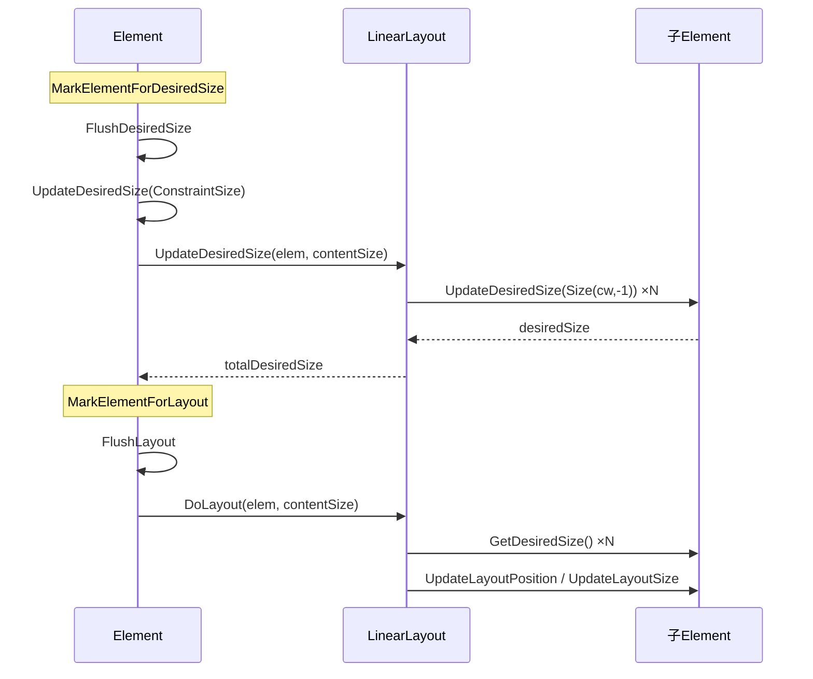

# LinearLayout 架构文档

> 版本：v1.1
> 状态：草稿
> 最后更新：2026-07-08 10:59
> 关联 PRD：docs/linear-layout/prd/PRD-linear-layout-v1.0.md
> 关联 Specs：docs/linear-layout/specs/SPEC-linear-layout-v2.0.md

> v1.1 变更（相对 v1.0）：
> - 布局工厂注册表（g_LayoutFactoryTable + LookupLayoutParser）移至 UIParser.cpp 内部，不再依赖 Layout 基类
> - LinearLayout 方向与交叉对齐为构造时确定、不可变（去掉 Setter，保留 Getter）

## 1. 架构目标与范围

### 1.1 目标
为 MegaUI 框架实现首个可用的布局系统，以 `LinearLayout` 为起点，建立从属性定义 → 布局计算 → XML解析的完整链路。

### 1.2 范围
- `LinearLayout`：继承 `Layout`，实现垂直/水平线性排列
- `Margin` 属性：Element 级外边距，类型 `UnitRect`
- `Layout` 基类扩展：静态工厂注册表 + `LookupFactory`
- `UIParser` 适配：`ValueType::Layout` 解析分支

### 1.3 非范围
- 不实现 Nested Layout（子容器嵌套布局）——由 Element 生命周期自然支持
- 不实现子元素 Alignment / Wrap
- 不修改 `Layout` 基类虚函数签名

---

## 2. 组件视图

```
┌────────────────────────────────────────────────┐
│                  UIParser                       │
│  ParserValue() → case ValueType::Layout        │
│  ParserLayoutValue()                           │
│    → LookupLayoutParser(name)  [内部静态]       │
│    → pfnParser(ExprNode, &pLayout)             │
│    → Value::CreateLayout(pLayout)              │
│  + g_LayoutFactoryTable[] [文件作用域]          │
│  + ParserLinearLayout() [内部静态]              │
└──────────────────────┬─────────────────────────┘
                       │
┌──────────────────────▼─────────────────────────┐
│                  Layout (基类)                   │
│  + DoLayout() / UpdateDesiredSize() [虚]         │
│  （本次无变更）                                  │
└──────────────────────┬─────────────────────────┘
                       │ 继承
┌──────────────────────▼─────────────────────────┐
│              LinearLayout                       │
│  + Create(Orientation, CrossAlign) → Layout*    │
│  + GetOrientation() / GetCrossAxisAlignment()  │
│  + DoLayout() override                          │
│  + UpdateDesiredSize() override                 │
│  - UpdateDesiredSizeVertical/Horizontal         │
│  - DoLayoutVertical/Horizontal                  │
│  （方向/对齐由构造时确定，不可变）                │
└──────────────────────┬─────────────────────────┘
                       │ 读取
┌──────────────────────▼─────────────────────────┐
│                  Element                        │
│  + Margin 属性 (UnitRect)                       │
│  + CmpMargin (像素缓存, 框架自动计算)             │
│  + GetDesiredSize()                             │
│  + UpdateDesiredSize() [启用Layout路径]          │
│  + FlushLayout() → DoLayout()                   │
└────────────────────────────────────────────────┘
```

---

## 3. 调用链与数据流

### 3.1 布局计算流水线



> Element 生命周期保证 `FlushDesiredSize` 先于 `FlushLayout`。因此 DoLayout 阶段 `GetDesiredSize()` 必定有效。

### 3.2 UIParser 解析流水线

```
XML: Layout="LinearLayout(Horizontal)"
            │
            ▼
     ValueParser::Parse()
            │
            ▼
   ExprNode Tree:
   Funcall("LinearLayout", [BaseIdentifier("Horizontal")])
            │
            ▼
   UIParser::ParserValue() → case ValueType::Layout
            │
            ▼
   UIParser::ParserLayoutValue()
     → 提取名称: "LinearLayout"
     → LookupLayoutParser("LinearLayout") → &ParserLinearLayout
     → pfnParser(ExprNode, &pLayout)
            │
            ▼
   ParserLinearLayout() [UIParser.cpp 内部静态]
     → UIParser::ParserFunction("LinearLayout", ...)
     → LinearLayout::Create(Horizontal, Stretch, &pLayout)
            │
            ▼
     Value::CreateLayout(pLayout)
```

---

## 4. 集成点

| 集成点 | 位置 | 说明 |
|--------|------|------|
| Element 属性系统 | `_MEGA_UI_ELEMENT_PROPERTY_TABLE` | Margin 属性行插入到表中 |
| Element::UpdateDesiredSize | `Element.cpp` ~3130行 | `#if 0` → 启用 Layout 路径 |
| Layout 工厂注册 | `UIParser.cpp` 文件作用域 | `g_LayoutFactoryTable` + `LookupLayoutParser` 注册 LinearLayout |
| UIParser::ParserValue | `UIParser.cpp` switch-case | 新增 `case ValueType::Layout` |

---

## 5. 扩展性设计

### 5.1 新增布局类型

只需两步：
1. 实现 `Layout` 子类（含 `DoLayout`/`UpdateDesiredSize`）
2. 在 UIParser.cpp 的 `g_LayoutFactoryTable` 中注册一行，并新增对应的内部静态解析函数

UIParser 和 Element 核心流程无需任何修改。

### 5.2 LayoutParserFunc 签名

```cpp
typedef HRESULT(__YYAPI* LayoutParserFunc)(
    _In_ ExprNode* _pExprNode,
    _Outptr_ Layout** _ppLayout);
```

各布局的解析函数在 UIParser.cpp 内部实现为文件作用域静态函数，自行解析参数语义；UIParser 只负责"名称→函数→调用"这一通用流程。

### 5.3 未来可扩展点
- `ParserLayout` 可扩展更多参数（如 Spacing），只需在 `_Args[]` 中追加
- Layout 可在 `DoLayout` 中调用子元素的嵌套 Layout，自然支持嵌套布局

---

## 6. 典型时序

### 6.1 垂直布局 3 个子元素

```
Container: Width=400, Height=auto

Child A: Margin(top=10, bottom=5), DesiredSize=(100, 50)
Child B: Margin(top=15, bottom=0), DesiredSize=(200, 80)
Child C: Margin(top=0,  bottom=8), DesiredSize=(150, 40)

UpdateDesiredSize:
  height = 10 (A.top)
         + 50 (A.h)
         + max(5, 15) (A.bottom vs B.top) = 15
         + 80 (B.h)
         + max(0, 0) (B.bottom vs C.top) = 0
         + 40 (C.h)
         + 8 (C.bottom)
         = 203
  width = max(100, 200, 150) = 200

DoLayout:
  A: pos=(0, 10),  size=(100, 50)
  B: pos=(0, 75),  size=(200, 80)
  C: pos=(0, 155), size=(150, 40)
```

### 6.2 水平布局 3 个子元素

```
Container: Width=auto, Height=300

Child A: Margin(left=10, right=5), DesiredSize=(50, 100)
Child B: Margin(left=15, right=0), DesiredSize=(80, 200)
Child C: Margin(left=0,  right=8), DesiredSize=(40, 150)

UpdateDesiredSize:
  width = 10 (A.left)
        + 50 (A.w)
        + max(5, 15) (A.right vs B.left) = 15
        + 80 (B.w)
        + max(0, 0) (B.right vs C.left) = 0
        + 40 (C.w)
        + 8 (C.right)
        = 203
  height = max(100, 200, 150) = 200

DoLayout:
  A: pos=(10, 0),  size=(50, 100)
  B: pos=(75, 0),  size=(80, 200)
  C: pos=(155, 0), size=(40, 150)
```

---

## 7. 部署视图

- LinearLayout 编译进 `MegaUI.lib`，无额外运行时依赖
- 布局逻辑为纯计算（float 算术 + 分支），不依赖任何 OS API
- `Margin` 属性存储在 Element 实例中，不额外分配堆内存

---

## 8. 稳定性与故障处理

| 故障场景 | 行为 |
|----------|------|
| 空子元素列表 | `UpdateDesiredSize` 返回 `Size(0,0)`，`DoLayout` 无操作 |
| 全部 LP_None | 同上 |
| 全部 LP_Absolute | 同上 |
| 容器 Size ≤ 0 | 返回 `Size(0,0)`，不崩溃 |
| 工厂查不到布局名 | `E_NOT_SET`，UIParser 报告 `ERROR_BAD_FORMAT` |
| `ParserFunction` 解析失败 | 错误直接传播，不创建垃圾 Layout 实例 |

---

## 9. 运维关注点

- 布局计算为同步操作，在 `FlushLayout` 调用链中完成
- O(n) 复杂度，n 为子元素数量，不建议在一个容器中放置数百上千子元素
- 如需调试布局，可在 `DoLayout` 中打印子元素的 `PosInLayout` / `SizeInLayout`
